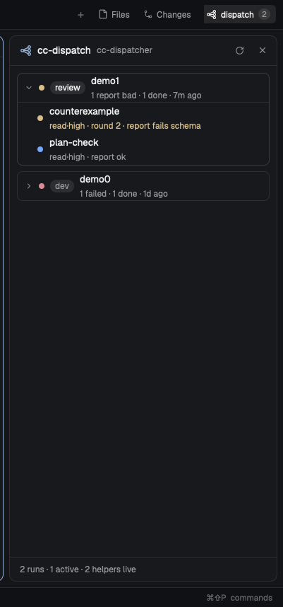

# Herdr + cc-dispatch

Herdr's default window with a "dispatch" button in the tab bar and a cc-dispatch panel beside the work area. Herdr's own Agents list keeps showing which helpers are live and what state they are in. The panel shows what only the cc-herdr-dispatch skills know: each dispatch run, every helper's round, whether its report passed the schema check, why it failed, and runs whose terminals are long gone. From a helper you can jump to it, peek at it, read its report or task file, see a worktree's changes, ask the Claude that dispatched it to look, or clean it up.

## What you see

Left to right, everything as in Herdr's `main` layout, plus two blocks:

- **Sidebar**, 268px: Herdr's brand bar, Spaces, Agents (helpers nest under the Claude that started them) and footer.
- **Work column**: the tab bar row, now `tabs` (weight 1) beside a 136px `cc-dispatch-toggle` block. The toggle sits at the block's left edge (the tabs block's 10px right padding is the gap) and is drawn like the tab bar's Files / Changes buttons (26px high, 8px side padding, 5px gap, 6px radius, 12px text): the 14px fork mark and "Dispatch", on `selected` while the panel shows; the block is wide enough that its rounded corners are not clipped, and a count badge when helpers are live: the number working on `working`, else the number live on `selected`.
- **cc-dispatch panel**, a 411px column (300–720px) right of the work area, top to bottom:
  - a 42px header: the mark in `accent`, "Dispatch" (no subtitle), a refresh button (a spinning ring while it reads) and a close button;
  - the run list, the only part that scrolls, one card per run (8px radius; live runs on `surface` with an `input` border, ended ones on `background`):
    - a 36px one-line head: a chevron, a status dot, the skill as a pill (research, review, dev, fix, test, probe, retro), the run id (`muted` once ended), the repository when it is not the shown one, then the run's control buttons as 22px solid chips with tooltips, a filled icon in `background` on the chip's color: a filled pause on `foreground` and stop (a hollow square) on `ansi1` while it runs, resume (play) on `accent` and stop while paused, none once stopping or stopped. No stage counts or age line: the group headers and the spend below say them. Live runs open by default; ended runs start folded. Clicking the head folds it. A run the person paused or stopped shows it in the head: the dot becomes a filled pause mark in `ansi3` (paused), a spinning ring in `ansi1` (stopping) or a `muted` square (stopped), and a paused card has an `ansi3` border.
    - under the head (folded or not) of a live or paused run, the main agent's quota when it is known: a `gauge` icon and "主 agent · Claude Code · pro" (or "Codex · prolite": the subscription of the program its terminal runs now) in `muted`, then each window that has not reset, "5h 50%" "7d 20%" "7d Fable 91%", in `muted`, `ansi3` (≥70%, semibold) or `ansi1` (≥90%, semibold); the tooltip lists when each resets and where the numbers came from. No row when nothing is known.
    - under that, the run's control line, when the run is paused, stopping or stopped or (open) can be: an icon and "已暂停 · 2 分钟前 · 挂起 1 个子 agent" in `ansi3`, "终止中 · 子 agent 正在写下做到哪了" in `ansi1`, or "已终止 · … · 总结已交给主 agent（Codex）" (the program from meta.json's `dispatcher_agent`, newest adopter first; just "主 agent" when unknown) in `muted` with a Summary button (stop.md in the text view), or, while the main agent hands the run off, "交接中 · 2 分钟前 · 把提示交给下一个主 agent" in `accent` (the run's dot is the `handover` icon in `accent`, the head has no control buttons) with a Package button (the package's handoff.md in the text view), a Copy prompt button (prompt.md to the clipboard with `cx.write_to_clipboard`, the label reads "已复制" for 2s) and a Retire button in `muted` (`archive` icon) for a handoff no main agent will adopt: a `control` dialog with op `retire` (500×330) says which helper terminals it closes (reports stay), that the run is marked finished and archived, and that dispatching to it again carries it on; Retire run runs `hd_dispatch.py retire --run` through `CONTROL_SCRIPT`, which refuses while a helper works (HELPERS_AT_WORK, shown in the dialog). A retired run (control.json `retired`) counts as settled for `canArchive` whatever its cards say. Under that, when the run's main agent is gone and the run is not done (`needsTakeover`), a line "主 agent（Codex） 已经不在了 · 把提示交给新的主 agent" in `accent` with the `handover` icon and a "复制接手提示" button (`takeoverPrompt`: a prompt naming the run's skill and folder that has a new main agent, Claude Code or Codex or any other, run `hd_dispatch.py takeover` and retell the state before doing anything; "已复制" for 2s). The head's control icons each open a confirmation dialog.
    - under that, even when the run is folded, "需要你处理 · n" in `ansi3` (or "已回答 · 等主 agent 处理" once all are answered; folds on its own, `groupFold` key `asks|<dir>`): one row per open item (`pendingItems`), the `decide` icon for a decision, `question` for a question, `check` once answered, then its title, its card, how long ago it was asked, and a line under it (`itemLine`: the option labels with ★ on the recommended one, the context, or "已回答 · <what was chosen>"). Clicking a row opens the decide dialog. Items are the run's `asks.json` (written by `hd_dispatch.py ask --add`), a `card:<id>` item for each card parked for the person that no ask names ("继续做" / "不做了"), and a `pending:<key>` item for each of an older run's state.json `pending_decisions` (a key naming a parked card, `<card>` or `<card>-…`, is folded into that card's item). Unanswered first, decisions before questions, oldest first. An item stays until the main agent closes it (`ask --resolve`) or the card's status changes; an answer counts only if given since the item was last asked.
    - under an open run's head, its spend: elapsed (or how long it took), shell commands, files patched, then for dev runs a "卡片 已合并 n/m" line, n merged (or done) out of m cards still meant to be merged (parked ones are not; `cardView`), and a bar of all cards split by card status (merged/done `ansi2`, reviewing `accent`, in progress `working`, queued `selected`, parked `muted`) with a key under it that wraps to more lines when narrow ("已合并 9 · 验收中 1 · 进行中 3 · 排队中 3 · 已搁置 2"). The card words differ from the helpers' stages on purpose: a card in progress is not a helper working (a helper reworking a card in review is working too). Cards are state.json's tasks without review calls (`<card>-check-r<k>`, `"check": true`) and the survey, which stats.js counts apart and which never get a stage of their own, then a "tokens" total with a bar split cached `ansi4` / new input `ansi6` / output `ansi3` and a key under it. No prices: Codex here runs through a router whose model names have no list price, and what it costs is billed there.
    - the helpers grouped by stage, most urgent group first (the order of the stage list below), dispatch order inside a group. Each group has a 28px header on `background`: a chevron, a 7px dot in the stage's color (a spinning ring for working), the stage's words (in its color; `muted` for settled stages) and a count pill on `selected`. Clicking the header folds the group. Settled groups (report ok, merged, done, parked, ended) start folded unless they are the run's only group.
    - after the stage groups, "还没有子 agent" (a hollow dot, open at first): the cards no helper of the run stands for and that are not merged or parked, others first, then queued ones; each a row with a hollow dot, the card id, its title in `muted` and its status as a tag, and under it "等 A、B" (its `depends_on` not yet merged) or its note.
    - one 30px one-line row per helper in an open group, indented 28px: a terminal dot, the helper's call id and its `--title` (meta.json `title`, Chinese), or its terminal name when it has no title (the one Herdr's Agents list shows; `foreground` while its terminal is open, `muted` once closed; a helper whose meta.json says `open: false` counts as closed even while the app's terminal list, which can lag herdr-core, still has its terminal), then small monospace tags on `selected`: mode and effort as two letters (`wh` write·high, `rm` read·medium, `n` net), the round past the first (`r2`), a failure word in `ansi1`, a retry count (`1/4`) in `ansi3`, the agent when it is not Codex (`claude`, in `ansi3`: weak isolation), `→ codex` in `accent` while a handover is under way; its tokens at the right. No stage tag: the group header says it; rounds in detail are in Task.
    - The row's dot is the terminal only: a filled pause mark in `ansi3` for a helper the run's pause stopped, a spinning ring in `working`, filled `blocked` when waiting on you, filled `foreground` while open, hollow `muted` once closed. The run's dot is its most urgent stage's color.
    - Stage tags (`STAGE_WORDS`, Chinese like the rest of the panel; agent and skill names stay English): 等你 `blocked`, 失败 `ansi1`, 重试中 `ansi3`, 已暂停 `ansi3` (group header with the pause mark), 进行中 `working`, 回报不合格 `ansi3`, 待收回报 / 待验收 / 验收中 `accent`, 回报合格 `done`, 已合并 / 已完成 `ansi2`, 已搁置 / 已结束 `muted`. Counts follow the word ("进行中 2"); failure categories read as words (`FAILURE_WORDS`: 额度用完, 登录失效, 上下文满, 服务繁忙…).
    - Clicking a row opens it on `raised`, indented like the name: its tokens, commands and files patched in `muted`; then two rows of separate outlined buttons (28px high, 6px radius, `border`, no fill, 6px gaps, icon and word centered), each ending in a 28px square column so the edges line up: 结果 (Result), 任务 (Task), then, live only, 查看 (jump to its terminal; else an empty cell), and Clean up as a `trash` icon in `ansi1` in the square (tooltip "清理"; empty when not live); under them, on the same three columns (so each is as wide as 结果), "询问" in `accent` when the helper needs its main agent, and "移交…" (any helper without a good report, while its run is running and no handover is under way). Above the grid, a helper running as Claude Code says "Claude Code · 弱隔离：没有沙箱，只靠任务文件里的规定让它待在自己的目录里" in `ansi3`; one being handed over says so in `accent`. Result and Task open as outlined docs (see the doc view below): Result is `resultDoc`, Task is `taskDoc`. No Go to: 查看 shows the helper over the current tab.
    - between the spend and the helpers, the main agent's background tasks on `background`: a "后台任务 · 主 agent" line with how many run, then one row per task, indented 28px and smaller than a helper row: a kind icon (`terminal` shell, `eye` monitor, `bot` agent; a spinning ring in `working` while a shell or monitor runs), the task's description, and its time ("已完成 · 3m", or failed / killed / lost in `ansi1` / `ansi3` / `muted`); a running shell's last output line or a monitor's last event, or an ended task's notification summary, under it in monospace. Three rows in all at first: every running task (all of them, even past three), then the ones that ended last, newest first, filling the rest; under them "更早的 n 个 · 再显示 5 个" (each click shows five more) and, once expanded, "收起" back to three rows. The expansion is kept per run while the panel lives. Clicking an ended task with an output file opens its last 200 KB in the text view (a Codex task, which has none, its kept log). Clicking a running shell or monitor opens a live dialog (`role: "bgtask"`, 860×620, re-read every 2s, "实时 · 每 2 秒刷新" with a spinning ring by the title): a line with how long it has run and the output file's size and last write; a one-line verdict (the busiest process and its CPU when one is running or above 20% CPU; else idle, "waiting … or stuck" once nothing was written for 5 min; or no process holds the file); the process tree in a code block (PID, state word, CPU%, CPU time, elapsed, the command indented under its parent, executables without their folder, Claude Code's wrapper shell shown as `sh: <task command>`); then the output's last 120 lines, or a note that many commands print only when they end. The skills' own `hd_dispatch.py wait` is not listed; while it runs the head says "waiting on helpers".
    - After six ended runs, "再显示 n 个更早的".
    - A settled run (every helper report ok, merged, done, parked or ended, live terminals or not, and the run not paused, stopping or handing off; `canArchive`, with the card statuses from state.json) has an `archive` icon at the end of its head (tooltip "归档：从面板上隐藏（文件保留）"): one click, no dialog, writes `<run>/archived` (epoch seconds; `ARCHIVE_SCRIPT`) and hides the card. Archived runs are listed under "已归档 n 个 · 显示" at the bottom (newest archived first), each with an `unarchive` icon that removes the marker and, beside it, a `trash` icon in `ansi1` (tooltip "删除：删掉这个运行和它留下的所有记录") that opens a `delete` dialog (500×360): what goes (the run folder with its helpers' meta.json, events, task files, screens, kept reports, asks, answers and handoff packages; the reports and progress notes under `$CC_HD_HOME/<tag>`; the worktree snapshots `refs/cc-dispatch/<run>/*`; the panel's cache entries; the retro ledger entry), the terminals still open that it closes, what stays (worktrees, `cc/<run>/*` branches, Codex's and Claude Code's own session logs), "删了就没法恢复。" in `ansi1`, and Cancel / Delete run (danger). Delete runs `hd_dispatch.py delete --run` through `CONTROL_SCRIPT`; it refuses a run without the `archived` marker (NOT_ARCHIVED) or one paused, stopping or handing off, and the dialog shows that line. An archived run stays hidden only while it is settled (`archivedAway`): a helper that needs someone again brings it back, and `hd_dispatch.py run` / `send` remove the marker. The footer counts archived runs apart ("· 已归档 n 个"). `LIST_SCRIPT` prints the markers ahead of the control.json files (`parseArchived`), after each run's `asks.json` and the last 50 lines of its `answers.jsonl` (`parseAsks`).
    - "其他空间": below the shown space's runs, one dashed row per other space with live runs: a dot (its most urgent stage), the space's name, "n 个运行" and its stage counts, a chevron. Clicking it shows that space (`space.select`), and the panel follows.
  - a 34px footer: "n 个运行 · n 个进行中 · n 个子 agent 在线" (and "n 项等你处理" when items are open) for the shown space, and a read error in `ansi3` when the spend or task script fails.
- Dialogs open as Herdr overlays: a text view (980×680 for Result and Task, which come with a doc; 760×600 otherwise) with a 排版 / 原文 (rendered / source) switch beside its title, the hand-off and the clean-up confirmations, the hand-over dialog (`role: "handover"`, 500×360: a Codex / Claude Code / Antigravity switch (the keys of model.js `AGENTS`), Codex first and marked "（新会话）" for the agent it already runs as; what happens to the helper, that the new agent starts on the same task and report as the next round, a weak-isolation warning in `ansi3` for Claude Code and Antigravity, whether the main agent is told, the log path), and the pause / resume / stop confirmations: what the action does to which helpers by name, what the main agent will see, Cancel and Pause / Resume (primary) or Stop run (danger); an error stays in the dialog in `ansi1`. The decide dialog (`role: "decide"`, 640×600): kind and card badges, the age, the context in markdown with the card helper's `open_questions` (from its report) and what it blocks appended; the options as cards with a radio dot, a "推荐" badge and "理由：" on the recommended one; a 3-row `Textarea` (gpui-base, created in `init`, styled here: an `accent` border while focused) for a note or, for a question, the answer; a preview of the message. Send appends the answer to `<run>/answers.jsonl` (`answerRecord`, `ANSWER_SCRIPT`: `{id, at, kind, choice, label, text, by: "panel"}`) and, when the run's main agent (control.json's `owner`, else the run's `parent`) is there and not blocked, `hc send`s it the message (`answerText`: card items say carry on or drop with `run=` and `call=`; other items name the item, the choice and the note, and ask it to act per herdr.md 待决项 and `ask --resolve`). Otherwise the button reads "保存回答" and the main agent, or the one that takes over, reads it from `answers.jsonl` (`hd_dispatch.py wait` returns `WAIT=answer`; `wait`/`collect` print `ANSWERS=` and `ANSWER <id>:`).

## How it behaves

- The panel follows the shown space. In the focused terminal's folder (else the space's folder) it finds the git top level and reads `<repo>/.cc-dispatch/*/agents/*/meta.json`. It also reads the run folder of every live terminal labelled `cc.dir`, so helpers of another repository still show.
- Live data comes from `terminals()`: herdr-core labels each helper `cc.run`, `cc.call`, `cc.kind`, `cc.dir`, `cc.mode`, `cc.round`, `cc.report`, `cc.failure`, `cc.retry` (`shared/scripts/hd_dispatch.py` sets them on run, send and collect; `cc.retry` is `capacity 1/4` while it retries a busy server or rate limit; `cc.net=down` while the network is down). A label wins over `meta.json` while the terminal lives; after, `meta.json`'s `report_check` and `failure` speak for it. When the helpers' terminals or labels change, the panel rereads at once; otherwise every 4 s while shown, and not at all while hidden.
- Stages (`callStage`), most urgent first. The helper's own trouble first: blocked → waiting on you; error, or a failure other than exited/blocked → failed; live with `cc.net=down` (not blocked, not held) → waiting for network (yellow, a note above the actions says it carries on by itself); stopped with `cc.retry` set → retrying (yellow; the detail line says `服务繁忙 重试 1/4`); held by the run's pause and not working → paused; working; report fails schema → report bad. Then its card in the run's `state.json` (dev runs; the call id is the card id): merged, parked, done (surveys) as is, accepting → in review. Then the report: settled and live with no verdict → to collect; report ok while the card is still running/pending → awaiting review (Claude has not picked it up); report ok with no card → report ok; else ended. A run takes its most urgent helper's.
- Spaces (`runSpace`): a run belongs to its main agent's space, from that terminal's `herdr.space` label while it lives, else the `space` `hd_dispatch.py run` recorded in `meta.json`, else the space whose folder is in the run's repository. The panel lists the shown space's runs, live and ended (and runs of no known space in its repository); other spaces' live runs only as their "其他空间" rows; other spaces' ended runs not at all.
- Background tasks (`bg.js`, run with `python3`): one adapter per main-agent program (`ADAPTERS` in `BG_PY`: `claude`, `codex`), each knowing a session's log (`path`), how to find a session that was not recorded (`find`) and how to read the log's background tasks (`scan`, from where the last read stopped). Every adapter gives the same task shape (`id, use, agent, kind, title, command, started, ended, status, summary, event, output, log, tail`), so the panel shows every main agent's tasks the same way. A run's main agents are `runMains` in model.js: every call's `dispatcher_agent` (`mainKey`: claude / codex / agy; not recorded means claude) with its `session`, newest first, then the ones a takeover replaced (meta.json `mains`, kept by `adopt`: [{terminal, agent, session}], oldest first); a session-less entry is kept only for a program with no recorded session. `bgRequest` sends one entry per main agent; a program without an adapter is skipped by the script (agy has none: its conversations are protobuf, so its background tasks are not shown). Claude Code (`claude`): `hd_dispatch.py run` records `CLAUDE_CODE_SESSION_ID` as `session` (with `parent`, `space`, `claude_cwd`). Its transcript `~/.claude/projects/*/<session>.jsonl` gives the tasks: a `tool_use` of Bash with `run_in_background`, Monitor, or Agent becomes a task when its result names a background task id (`backgroundTaskId`, `taskId`, or an async `agentId`); a foreground Bash call counts too when its result says it was moved to the background after its timeout; a `<task-notification>` with a `<status>` ends it, one with only an `<event>` updates it. A successful `TaskStop` (or the older `KillShell` / `KillBash`) ends its task as killed, since no notification follows one; and a running shell whose output file ends in `[killed]` or `[exited with code N]` is ended at the file's mtime (killed, completed for 0, else failed), a marker the row's tail leaves out. Without a session: the newest transcript under the Claude's folder (else the repository's) that names the run folder. Tails come from the task's `.output` file. Codex (`codex`): threads are rows of `threads` in `<CODEX_HOME>/state_*.sqlite` (every `~/.codex*` home and `$CODEX_HOME`, read-only through python's `sqlite3`), each with its `rollout_path`. Without a session (`CODEX_THREAD_ID` unset): the newest thread whose `cwd` is the run's, updated since the run began (less 10 min), whose first message is not a helper's `<hc …>` envelope and whose rollout names the run folder. In the rollout an `exec_command` call whose output says "Process running with session ID N" is a process; `write_stdin` calls on N poll it, and "Process exited with code X" ends it (completed for 0, else failed with "退出码 X"; killed when the poll sent ^C), "Unknown process id N" ends it as lost. A process is a background task once the agent makes any other call while it runs (the hd wait always is); one only polled until it ended was a slow foreground command and is dropped. A Codex task has no output file: `log` keeps the polled output's last 6000 characters, its tail is that text's last lines, and clicking it shows `log` in the text view (no live dialog). Found sessions are remembered; a miss is retried after 2 min. For a run adopted before `mains` existed, the script also reads `from` in its `handoff/*/handoff.json` (once per package, cached). The script returns each run's sessions (`runs`: recorded, found or from a package) and each session's tasks (`sessions`, those started since its earliest run less 10 min, the last 60). `assignTasks`: a task whose command names one of its session's run folders (`hd_dispatch.py wait --run …`) belongs to that run, any other to the latest run of its session that started before it (less 5 min). The live dialog's `LIVE_SCRIPT` (sh) prints the file's size and mtime, `lsof -t` of the file (the shell Claude Code started holds it open), the whole `ps -Ao pid,ppid,stat,etime,time,%cpu,command` table and the file's last 24 KB; `parseLive` keeps the tree under the holding shell. With the main agent's terminal gone, a task still marked running shows "lost". Read with the spend (cache `$CC_HD_HOME/.panel-bg.json`, v4).
- Quota (`runQuotaAgent`, `quotaView`, `QUOTA_SCRIPT`): the main agent is the run's parent terminal; its `program.key` (else its argv's program, else meta.json's `dispatcher_agent` once it is gone) says claude or codex. `QUOTA_SCRIPT` (sh) runs `python3 hd_usage.py quota <agent> --slow` from beside the recorded `hd` (else `~/.claude/skills`), which answers magpie's reading of the account it served last (its gateway, else `magpie quota --json`), Codex's own session log as a fallback, or null. Read with the list, at most every 30 s per agent; a failed read keeps the last value.
- 查看 (`goTo`) focuses the pane showing the helper if one does; else it focuses its main agent's pane, which brings that agent's tab forward, and peeks at the helper there (`terminal.peek`). A helper started with `hc run` has no pane of its own and belongs to its parent's tab, so peeking without going there first opens it on a tab that is not shown, and the click seems to do nothing.
- Spend (`stats.js`, run with `python3`): a helper's sessions are its Codex threads and, when a handover ran it as Claude Code, every session in meta.json's `claude_sessions` (`~/.claude/projects/*/<session>.jsonl`; each message counted once, input including cache reads and writes, cached = cache reads, Bash calls as commands, Edit/Write paths as files). A closed helper's spend is the last `codex` event in its `agents/<call>/events.jsonl` (written by `hd_dispatch.py` when it settles), taken as is even after Codex pruned its logs; a live helper's `codex` event names its rollout logs, which are then scanned without the sqlite search. A `handover` event after the last `codex` event voids it (the new session is not in it), and the logs are searched again. Without an event, a helper's Codex threads are the ones in `<CODEX_HOME>/state_*.sqlite` whose first message names one of its `agents/<call>/task-<k>.md`; every `~/.codex*` home is searched. Its session log gives the last `token_count` totals, `exec_command` calls and the paths in `apply_patch`es; logs are read from where the last read stopped (cache `$CC_HD_HOME/.panel-stats.json`). Cards come from the run's `state.json` `tasks[*].status`; its `pending_decisions` come back as `pending` (an older run's way of listing what waits on the person). Live runs are re-read every poll, ended runs once. If the script fails, the footer says why.
- The doc view (Result, Task; `renderDoc`): a doc is `{nodes: [{id, title, tone, badge, blocks, children: [{..., depth}]}]}` from model.js, tones ok `ansi2`, bad `ansi1`, warn `ansi3`, info `ansi4`, accent, muted. Left, a 230px scrolling outline on `raised`: "全部", each node (tone dot, semibold, badge on the right) and its children indented by depth with small dots. Clicking one shows only that part on the right (with "node ›" above a child, and the children nested under it); there is no scrolling to it, since Herdr can't scroll a plain area from code. Each part: a heading with an `accent` bar and its badge as a pill, then its blocks: lead (a conclusion on `raised` with a tone bar; a verdict or status as large colored text, a summary or answer in bold), kv (128px keys in `muted`, values colored by tone with a dot); report field names and short enum values are shown in Chinese (`FIELD_WORDS`, `VALUE_WORDS` in model.js), others as they are, md, code (monospace box), files (a one-letter mark A/N/M/D/R/! and the kind in its color: added `ansi2`, new (untracked) `ansi6`, modified `ansi3`, deleted `ansi1`, renamed `accent`, conflict `ansi1`), stat (each path's lines as a 110px green/red bar), events (time, tone dot, words; bad and warn in their color).
  - Result: Overview (verdict or status as a lead, toned by `wordTone`; summary, answer and recommendation as leads; schema check, report, schema, earlier rounds), then a node per remaining field (a list of objects as numbered children toned by severity / priority / verdict / status; failures bad, open questions and deviations warn), then "工作树里的改动" with Files (badge counts per kind) and Lines changed.
  - Task: Overview (call, title, mode · effort, agent, round k of n, report, failure (exited `muted`, blocked `ansi3`), worktree, and a line per round: how, when, how it settled), then a group per round, newest first, "第 k 轮 · 首次派发 / 返工 / 已移交" (badge "当前"): Timeline (its events), task-k.md, and the file's headings as children nested by level.
- The text view without a doc renders markdown (`TextView.markdown`, selectable, in an 8px-radius `background` box that scrolls) and Source shows the text as read, in monospace. Result's report part is the verdict, report, schema and earlier rounds as a list, a rule, then the report JSON as markdown (`jsonMarkdown`): each top-level field a `##` section, prose as prose, a list of objects as numbered `###` items titled by their title/name/id/task/file/path/summary, other values as nested bullets with keys in bold, short identifiers in code, multi-line values (logs) in code blocks. A report over 300,000 characters shows as source. Its changes part puts the `branch @ dir` line under the heading and the rest in a code block.
- Run control: `hd_dispatch.py pause|resume|stop --run <dir>` keeps the run's state in `<run>/control.json` (`state` running / paused / stopping / stopped / handoff, `at`, `held` calls, `report` = stop.md; handoff adds `prev`, `seq`, `why`, `package`, `prompt`; after `adopt`, `owner` is the new main agent's terminal); the list script dumps it ahead of the meta.json files (`parseControls`), and a paused run marks its `held` calls. The dialog runs `CONTROL_SCRIPT` with the `hd` path `hd_dispatch.py run` recorded in meta.json (else the first `~/.claude/skills/cc-herdr-dispatch-*/shared/scripts/hd_dispatch.py`), with `~/.local/bin`, `/opt/homebrew/bin` and `/usr/local/bin` put first on PATH; pause and resume run in the foreground, stop goes to the background (`nohup`, logging to `<run>/stop.log`) since helpers get up to 3 minutes to write what they have. The dialog closes on success; `RUN_CONTROL=` in the output (the run had already moved on) shows as "什么都没做".
- Task renders `agents/<call>/events.jsonl` and every `task-<k>.md` by round (`roundsMarkdown`): one line per event, `MM-DD HH:MM:SS · <words>`: dispatched, retry scheduled / told to carry on, settled with report and failure, stalls, Codex totals so far, cleaned up, paused / resumed / run stopped, frozen (why, whether it wrote a note, the snapshot), handed over (from → to, weak isolation), adopted by a new main agent, network down (waiting, no retry used) / network back, interrupted (its terminal vanished), recovered (own session reopened or a new one read the task). Calls from before the log existed say so.
- Result's source shows the verdict, the report and schema paths (the run folder's `report-r<k>.json` copy when the /tmp one is gone), earlier rounds' `report.r<k>.json` (else `report-r<k>.json`), the report as pretty JSON, then `git status --short` and `git diff --stat HEAD` in the helper's worktree. Task's source is each task file, newest first, then events.jsonl.
- Takeover (`needsTakeover`): a run needs a new main agent when it has calls, is not stopping or handing off, is not marked done (state.json's `finished`, read by the stats script), its main agent's terminal (control.json's `owner`, else the newest call's `parent`) is gone or back at a shell (`agentIn`: herdr's `program.key`, else `foreground.argv[0]` unless a shell), and it is paused, stopped, has a lost helper, or still has helpers or cards open (`!canArchive`). `hd_dispatch.py runs` lists the same runs for a skill; `takeover` recovers lost helpers and adopts the run in one step, and refuses while the old main agent still runs unless `--force`. Main-agent programs are generic: the script's `MAIN_AGENTS` registry gives each one's session variable and resume command (Claude Code, Codex, Antigravity: `ANTIGRAVITY_CONVERSATION_ID`; when none was recorded its conversation id is looked up in `~/.gemini/antigravity-cli/conversations/*.db` by the run folder); another program still takes over, without a resume command.
- A helper's parent is hc's `parent` while it lives, except once a new main agent ran `adopt`: hc's parent is set at start and never changes, so meta.json's `parent` (with `adopted.from`) wins then.
- "询问" appears for blocked, failed, schema-failing and uncollected helpers (`handoffAsks`). A good report on a card still pending or running (awaiting review) gets "请求验收" instead; a card parked for the person to decide (`parkedWhy` "user": state.json's `parked_why`, else read from its note) gets "决定…" (`ansi1`), or "已回答 · 修改…" once answered, opening the decide dialog on its item. An opened row also says what the card is: "卡片已搁置 · 等你决定 · <note>" in `ansi3`, or superseded by X / dropped / its note in `muted`. It asks the helper's main agent (whatever program it is): its parent terminal (the one that dispatched it, or adopted the run), else the focused agent, else the last one focused. The dialog shows the exact message; Send runs `hc send` and focuses that agent. Sending is off while that agent is blocked or gone.
- Hand over runs `CONTROL_SCRIPT` with `handover <run> <call> <agent>`: `hd_dispatch.py handover --run --call --to <agent> --why manual --notify` in the background (`nohup`, logging to `agents/<call>/handover.log`), since freezing gives the helper up to 3 minutes to write its note. hd_dispatch.py labels the old terminal `cc.handover=<agent>` while it freezes; the new terminal carries `cc.agent`. The dialog closes once it has started; the main agent gets a message naming the package.
- Clean up asks first, then runs `hc kill` and `hc rm` on the helper. Its `meta.json`, task files and report stay, so the run keeps its history. Its main agent is not told.
- The toggle and close button run `layout.toggle` / `layout.hide {id: "cc-dispatch-panel"}`; the node's hidden state survives space switches and restarts.

## Built from

- `layouts/herdr-cc-dispatch.json`: a clone of `main` (Herdr app 0.1.13, `cloned_from` recorded) with two changes:
  - the tab bar block becomes `{ "id": "tabs-row", "type": "row", "size": { "px": 42 }, "resizable": false, "children": [ the tabs block with "size": { "weight": 1 }, { "id": "cc-dispatch-toggle", "type": "block", "content": { "mod": "cc-dispatch", "props": { "role": "toggle" } }, "size": { "px": 136 } } ] }`;
  - `work-body` gains `{ "id": "cc-dispatch-panel", "type": "column", "size": { "px": 411 }, "min": 300, "max": 720, "children": [{ "id": "cc-dispatch", "type": "block", "content": { "mod": "cc-dispatch" } }] }`.
  - Root `"preview": "layouts/herdr-cc-dispatch.png"`.
- `mods/cc-dispatch/`:
  - `main.js`: the views and roles (`props.role`): the panel by default, `toggle`, and the dialogs `text`, `handoff`, `handover`, `cleanup`, `control`, `decide`. The only file that imports `herdr`.
  - `model.js`: parsing the `meta.json` dump, merging it with terminals, statuses, wording, the shell scripts.
  - `loader.js`: the reads (repo, runs, report, task, earlier rounds, worktree changes, spend), with I/O passed in.
  - `stats.js`: the spend script and its totals and wording.
  - `bg.js`: the background-task script with its adapter per main-agent program (Claude Code, Codex), assigning tasks to runs, and what a run shows of them.
  - `mark.svg` and `icons/`: 24px stroke icons drawn with `svg()` in theme colors.
- Herdr functions: `exec`, `readTextFile`, `hc`, `terminals`, `agents`, `panes`, `spaces`, `focused`, `layout`, `theme`, `settings`, `props`, `openOverlay`, `closeOverlay`, `run`.
- Commands: `layout.toggle`, `layout.hide`, `pane.focus`, `terminal.peek`, `space.select`.
- Programs: `sh`, `cat`, `tail`, `python3` (spend, background tasks; Codex's thread tables through its `sqlite3`), `git` (`rev-parse`, `status`, `diff --stat`), `hc send|kill|rm`.
- Files read: `.cc-dispatch/*/agents/*/meta.json` and `task-*.md`, the reports under `$CC_HD_HOME` (default `/tmp/cc-dispatch`). Codex's thread tables and session logs, Claude Code transcripts and task output files (read-only). Files written (removed too: an archived run and what is kept of it, through `hd_dispatch.py delete`): the spend and task caches, a run's `archived` marker, and a run's `answers.jsonl` (one line per answer, appended).

## Watch out

- Herdr does not load a mod's SVGs through a symlinked mod folder (the code loads, the icons are blank). Copy the mod; `install.sh` does, and marks the copy with `.cc-dispatcher` so a rerun may refresh it. The layout file can be a symlink.
- Saving a mod file reloads it in place without running `init` again; switch layouts to start it fresh.
- `hc ls --json` has no labels; `hc get` and Herdr's `terminals()` do.
- Helpers that never ran `collect` have no verdict: "report not checked" is the truth, not an error.
- Remote spaces: `exec` and `readTextFile` take the space's machine, but helpers' run folders found through labels are read on that same machine.
- QuickJS rejects `??` mixed with `||`/`&&` without parentheses; `herdr-app check` catches it, node does not.
- A layout clone is never updated: rebuild from this recipe on a new Herdr version.

## Done when

- `node --test herdr/tests/*.test.mjs` passes.
- `herdr-app check ~/.config/herdr-app/mods/cc-dispatch` passes.
- `layout.switch {name: "herdr-cc-dispatch"}` shows the layout with no `.error` and empty `errors` in `herdr-app status`.
- The tab bar shows Files, Changes and Dispatch; Dispatch shows and hides the panel, and switching spaces keeps it as it was.
- With a run dispatched by a cc-herdr-dispatch skill, its card lists every call; a collected call shows its verdict, and after the helper's terminal is removed the card still shows it as ended.
